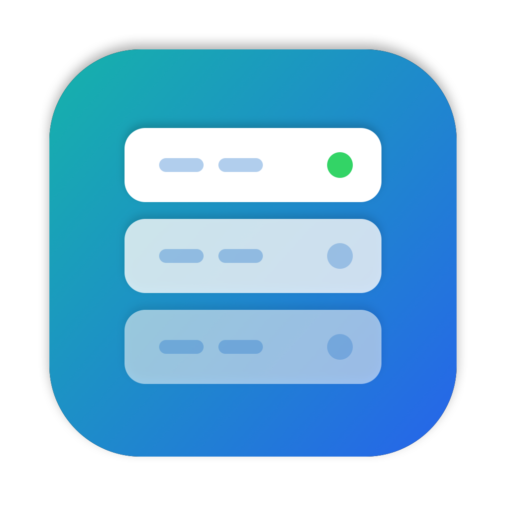

<p align="center">
  
</p>

# ColimaDeck

A native macOS app for managing [Colima](https://github.com/abiosoft/colima): your Colima machines, and the Docker containers, images and volumes running inside them, all in one window instead of a stack of terminal commands.

Built with SwiftUI. No Electron, no background daemon. It runs the `colima` and `docker` commands, and installs them for you if you don't have them yet.

## Features

### Machines
- A card for each Colima machine (profile) showing its status, CPUs, memory, disk, architecture, runtime and IP address
- Start, stop, restart, force stop, force restart and delete, with progress shown on the card
- **New Machine** and **Edit Settings** forms covering every `colima start` option: resources, architecture, custom disk image, runtime, Kubernetes version and k3s arguments, VM type (Apple Virtualization, QEMU, krunkit), Rosetta, binfmt, nested virtualization, hostname, shared folders, networking, DNS, SSH, environment variables and more. No config files to edit by hand: **Save** stores your changes, and **Save and Restart** applies them right away.
- Open a shell inside the machine in Terminal (`colima ssh`)

### Machine details
- Live status from `colima status --extended`, plus Colima and runtime versions
- **Kubernetes:** start, stop, reset and delete the cluster
- **Run a command** inside the VM and see its output
- **SSH connection** settings (`colima ssh-config`) to copy into tools like VS Code Remote
- **Update the container runtime** (`colima update`)
- **nerdctl** for containerd machines: install the `nerdctl` command on your Mac
- **AI models** (Docker runtime with the krunkit VM type): set up, list, pull, chat with and serve models

### Containers
- Grouped by Docker Compose project, with **Start All** and **Stop All** buttons for each project
- Live CPU and memory bars for running containers
- Published ports shown as buttons that open `http://localhost:<port>`
- Start, stop, restart, pause, resume and remove
- A side panel with the container's details and logs, which update as new output arrives
- Open a shell inside the container in Terminal (uses bash if it's there, otherwise sh)
- Filter by name, image or project, or show running containers only

### Images and Volumes
- Tables you can filter by name
- Pull images by name (for example `postgres:17`)
- Remove selected items, or delete everything unused with **Clean Up** (the app asks first)

### Tools
- Colima's version and location
- Create or edit the **template** new machines start from, in the same form as machine settings
- **Clean up** Colima's downloaded VM images (`colima prune`)
- Choose how much detail Colima prints in Activity (`--verbose`, `--very-verbose`)
- Set up **tab completion** for `colima` in zsh, bash or fish

### Activity
- The full output of every command the app has run, newest first. Failed commands open automatically so you can see why.

### Menu bar
- Start and stop machines, and see how many containers are running, without opening the window. Closing the window leaves the app running in the menu bar.

## Requirements

- macOS 14 (Sonoma) or later
- Colima and the Docker CLI. If they're missing, ColimaDeck offers to install them with [Homebrew](https://brew.sh) the first time you open it. If you don't have Homebrew either, it opens Terminal to install that first, because Homebrew's installer asks for your password. To install them yourself instead:

  ```sh
  brew install colima docker
  ```

- To build from source: Xcode or the Xcode Command Line Tools, with Swift 5.10 or later (`xcode-select --install`)

## Install

### Download

1. Download `ColimaDeck-<version>.dmg` from the [latest release](https://github.com/Fahimefto/ColimaDeck/releases/latest). It runs on both Apple Silicon and Intel Macs.
2. Open the DMG and drag **ColimaDeck** into **Applications**.
3. The app isn't notarized by Apple, so macOS blocks it the first time you open it. To allow it, open it once, then go to **System Settings → Privacy & Security**, scroll down, and click **Open Anyway**. Or run this in Terminal:

   ```sh
   xattr -dr com.apple.quarantine /Applications/ColimaDeck.app
   ```

### Build from source

```sh
git clone https://github.com/Fahimefto/ColimaDeck.git
cd ColimaDeck
./build-app.sh --install
```

This builds a universal release version and copies `ColimaDeck.app` into `/Applications`. Without `--install`, the app is left at `build/ColimaDeck.app`.

## Using it

1. If Colima isn't installed, the setup window installs it. Then open **Machines**. If you don't have a machine yet, click **New Machine**. The first start downloads a VM image, which can take a few minutes. You can follow its progress in **Activity**.
2. Once a machine is running, **Containers**, **Images** and **Volumes** show what's inside it.
3. If you have more than one machine, use the machine picker in the toolbar to choose which one the Docker screens show.

### A note on `docker context`

ColimaDeck connects to each machine's Docker socket directly (`~/.colima/<name>/docker.sock`), so it **never changes your active Docker context**. That means it works fine alongside OrbStack or Docker Desktop.

Colima itself is different: by default, starting a machine makes it your active context. To stop that, open **⋯ → Edit Settings** on the machine card and turn off **Make it the active context when it starts**.

## Troubleshooting

| Problem | Fix |
| --- | --- |
| "Colima isn't installed" | Click **Set Up** on the Machines screen to install it. The app looks for Colima in `/opt/homebrew/bin`, `/usr/local/bin` and the usual system folders. |
| Installing fails | Open **Activity** to see Homebrew's output. Running `brew doctor` in Terminal often explains why. |
| A machine won't start | Open **Activity** and expand the failed entry to see Colima's full output. |
| "Docker isn't available" | The machine uses containerd or Incus. The Docker screens need a machine running the Docker runtime. |
| **Open Terminal** does nothing | Allow ColimaDeck to control Terminal in **System Settings → Privacy & Security → Automation**. |
| You use a custom Colima home folder | Launch the app with `COLIMA_HOME` set, for example `COLIMA_HOME=~/vms open /Applications/ColimaDeck.app`. |

## Development

```sh
swift run          # build and run from source
swift build        # build only
./build-app.sh     # build the .app
./build-app.sh --dmg  # also package build/ColimaDeck-<version>.dmg
swift scripts/make-icon.swift  # redraw the app icon into Resources/
```

You can open `Package.swift` in Xcode to work on the UI with previews and the debugger.

To understand how the code fits together, see [docs/ARCHITECTURE.md](docs/ARCHITECTURE.md). Contributions are welcome; see [CONTRIBUTING.md](CONTRIBUTING.md).

## License

MIT. See [LICENSE](LICENSE).
